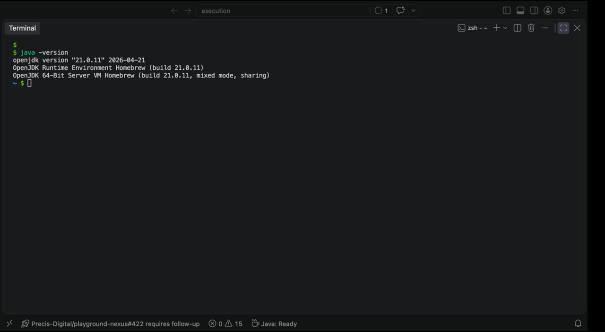
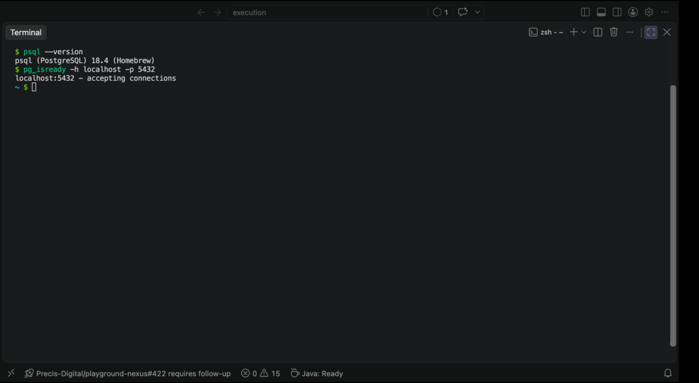
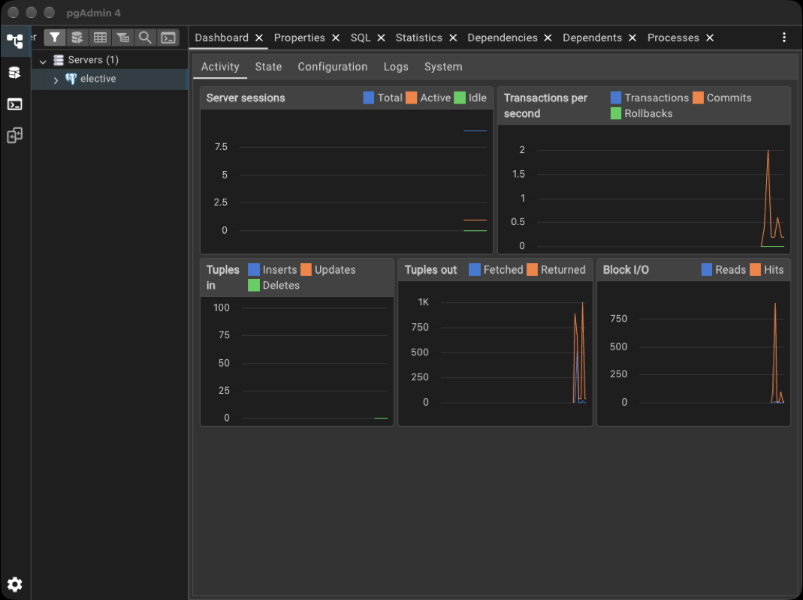
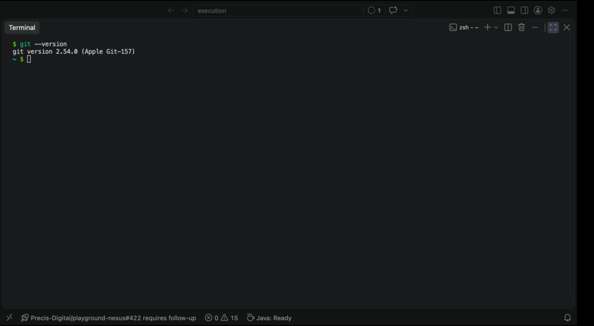
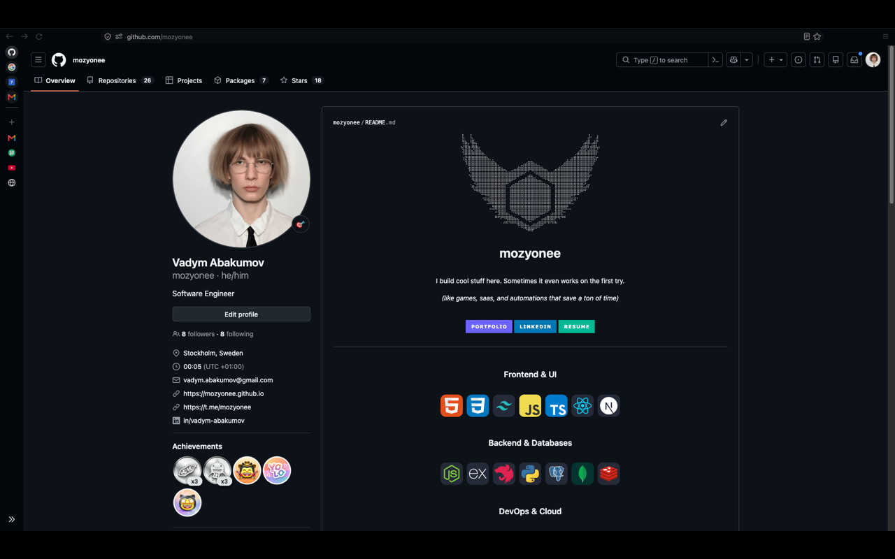
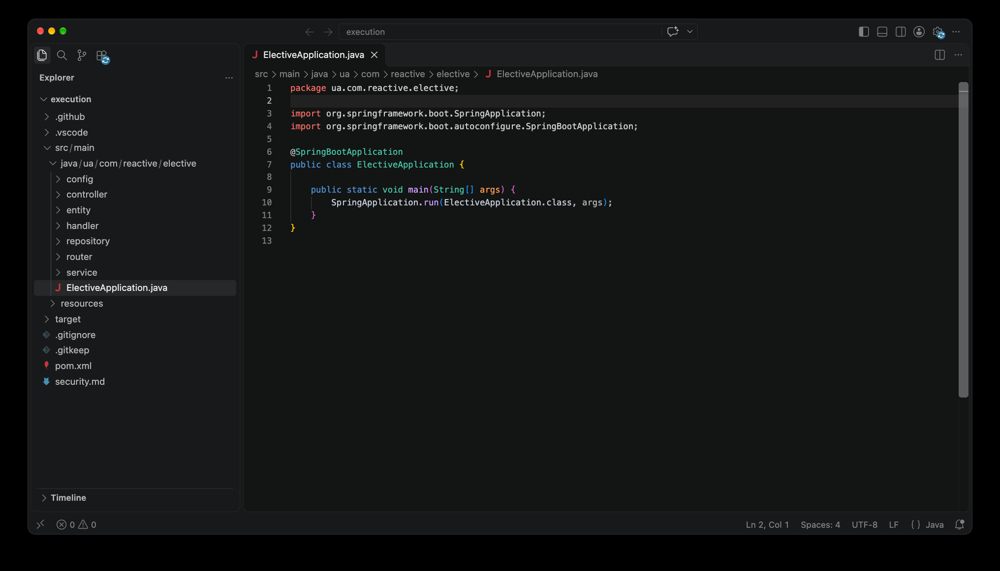
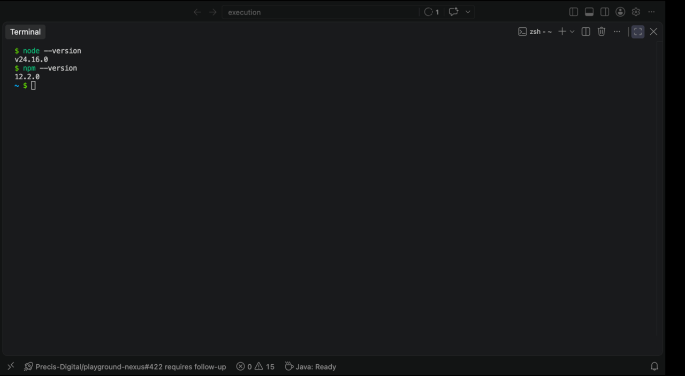
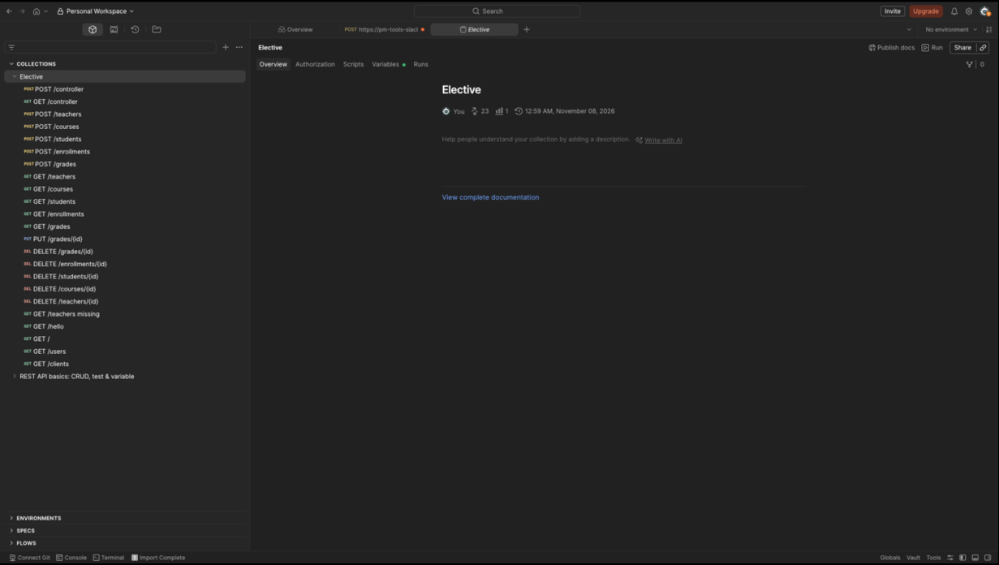

# Лабораторна робота №1. Середовище розробки

## JDK

`java -version`:

```
openjdk version "21.0.11" 2026-04-21
OpenJDK Runtime Environment Homebrew (build 21.0.11)
OpenJDK 64-Bit Server VM Homebrew (build 21.0.11, mixed mode, sharing)
```

Версія 21, вимога лабораторної — 17 або новіша.



## PostgreSQL

`psql --version`:

```
psql (PostgreSQL) 18.4 (Homebrew)
```

Сервер запущений: `pg_isready -h localhost -p 5432` відповідає `localhost:5432 - accepting connections`.

База `elective` створена. Підключення `postgres` / `postgres` на порту `5432` приймається: `SELECT current_user, current_database()` повертає `postgres` і `elective`.





## IntelliJ IDEA

IntelliJ IDEA не встановлювався. Середовище розробки — VS Code.

## Git

`git --version`:

```
git version 2.54.0 (Apple Git-157)
```



## GitHub

Обліковий запис: [mozyonee](https://github.com/mozyonee). Репозиторій проєкту: [elective-reactive](https://github.com/mozyonee/elective-reactive).



## Visual Studio Code

`code --version`:

```
1.136.1
a44adf7f53e00964ab890f9f8758a334f1fc15bc
```



## Node.js

`node --version` і `npm --version`:

```
v24.16.0
12.2.0
```



## Postman

Відкрита імпортована колекція `Elective` з `elective.postman_collection.json`.


